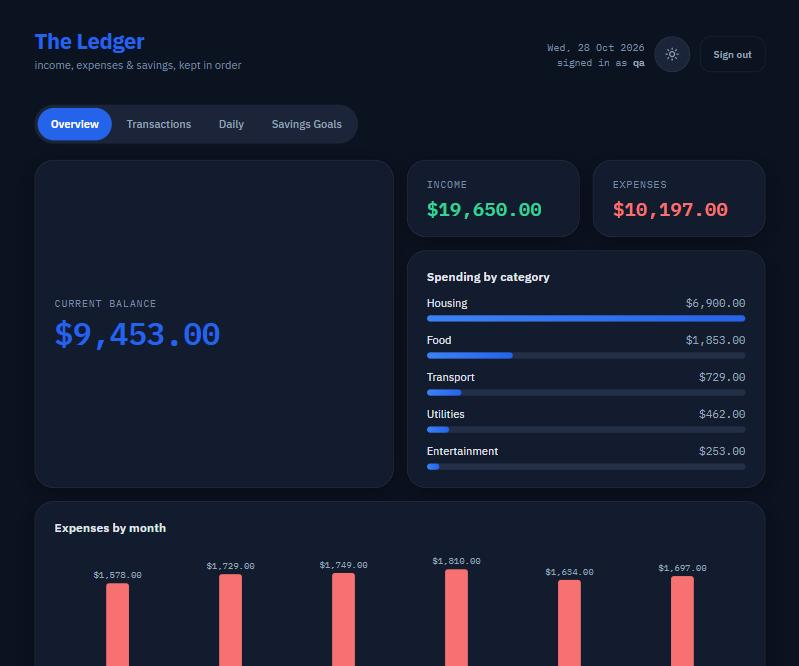

# The Ledger — Budget Tracker

A budget tracker built with vanilla HTML, CSS and JavaScript. No build step, no dependencies, no backend.

**Live demo:** https://sadullaev217.github.io/budget-tracker/



## Features

- **Overview**: balance, income and expense tiles in a bento grid, spending by category, and an expenses-by-month bar chart (hand-rolled SVG with hover and keyboard tooltips)
- **Transactions**: add and delete income or expense entries, grouped by month
- **Daily**: calendar view with income/expense dots per day; select a day to see and add its entries
- **Savings goals**: create goals and add funds with progress bars
- **Light and dark theme**: follows the system setting by default, with a manual toggle that is remembered
- **Local sign-in**: create an account and sign in; each username gets its own separate ledger

## Run it

Use the live demo, or clone the repo and open `index.html` in a browser. Fonts load from Google Fonts, so an internet connection gives the intended look; everything else works offline.

## Project layout

- `index.html`: page shell (plus a tiny inline script that applies the theme before first paint)
- `style.css`: all styles; light and dark themes are CSS custom properties
- `lib.js`: pure helpers (money in cents, dates, totals, data migration), shared by the app and the tests
- `app.js`: app logic and rendering
- `tests/`: unit tests for `lib.js`

## Tests

Requires Node 18 or newer:

```bash
node --test
```

## Data and privacy

All data lives in your browser's `localStorage`. Nothing is sent anywhere.

The sign-in is a local profile switcher, not real security. Passwords are hashed (SHA-256) before storage, but anyone with access to the browser's dev tools can read or bypass them. Don't treat it as protection for sensitive data.

## Tech

HTML, CSS (custom properties for theming), vanilla JS, IBM Plex Sans / Mono.
